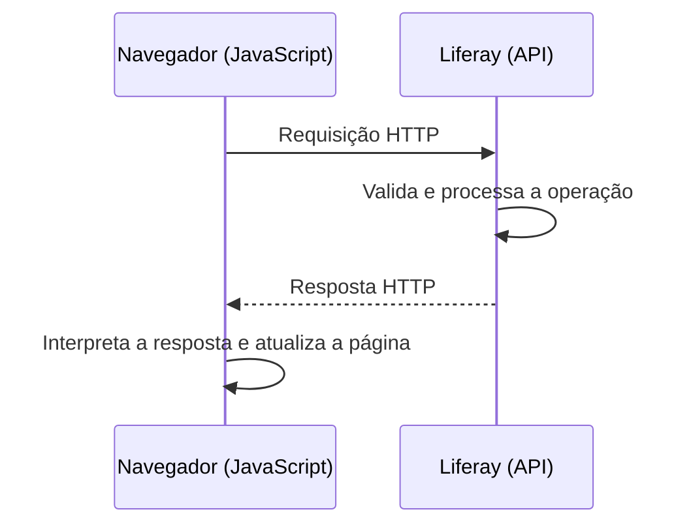
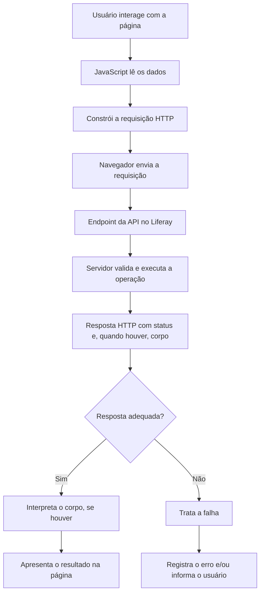

# JavaScript — Teoria

Este documento reúne os conceitos necessários para compreender como uma página HTML utiliza JavaScript para consumir APIs REST do Liferay. Ele serve de base teórica para os dois exercícios práticos: operações CRUD de **Blog Postings** e envio de arquivos para **Documents and Media**.

A ideia não é estudar todo o JavaScript nem todas as possibilidades da plataforma Liferay. O objetivo é entender o caminho que os dados percorrem entre a página e o servidor, o papel de cada parte da requisição e a maneira como o código lida com a resposta.

> **Atenção aos exemplos:** os endereços e identificadores usados neste documento são ilustrativos e pressupõem um Liferay executado localmente. O endereço, o `siteId`, as permissões e os recursos disponíveis podem ser diferentes no seu ambiente.

## 1. JavaScript no navegador

HTML e JavaScript desempenham papéis diferentes em uma página web. O **HTML** descreve a estrutura do conteúdo — formulários, campos, botões e áreas de texto, por exemplo. O **JavaScript** permite acessar essa estrutura, reagir às ações do usuário, alterar o conteúdo da página e realizar operações como enviar requisições HTTP.

Considere este formulário simples:

```html
<form id="myForm">
  <input type="text" id="titleInput" />
  <button type="submit">Enviar</button>
</form>

<div id="output"></div>
```

O atributo `id` identifica cada elemento na página. O JavaScript pode obter uma referência a esses elementos com `document.getElementById()`:

```javascript
const myForm = document.getElementById("myForm");
const titleInput = document.getElementById("titleInput");
const output = document.getElementById("output");
```

Essas variáveis não contêm simplesmente o texto dos elementos: elas guardam referências aos próprios elementos HTML. A partir delas, o programa pode ler valores, registrar eventos ou atualizar a página.

### Eventos e funções

Um **evento** é algo que acontece durante a interação com a página, como um clique ou o envio de um formulário. `addEventListener()` registra uma função que será executada quando o evento ocorrer.

```javascript
myForm.addEventListener("submit", (event) => {
  event.preventDefault();

  output.textContent = `Título: ${titleInput.value}`;
});
```

Nesse exemplo:

- `"submit"` identifica o tipo de evento que será observado.
- A função passada como segundo argumento será executada quando o formulário for enviado.
- `event` representa informações sobre o evento ocorrido.
- `event.preventDefault()` impede o comportamento padrão de envio do formulário, permitindo que o JavaScript controle o que acontece em seguida.
- `titleInput.value` lê o valor digitado no campo.
- `output.textContent` apresenta o resultado como texto.

Existe uma diferença importante entre **registrar uma função para ser executada depois** e **chamar uma função imediatamente**. Em `addEventListener("submit", minhaFuncao)`, passamos a referência da função. Em `minhaFuncao()`, os parênteses fazem a chamada da função naquele momento.

Essa distinção é útil quando uma requisição à API deve acontecer apenas depois de uma ação do usuário, como clicar em um botão de upload.

## 2. Cliente, servidor e comunicação HTTP

Quando o JavaScript precisa obter ou modificar informações armazenadas no Liferay, ele não acessa diretamente o banco de dados. Ele envia uma **requisição HTTP** a um endpoint disponibilizado pelo servidor. O Liferay recebe a requisição, verifica aspectos como autenticação, autorização e validade dos dados, executa a operação solicitada e devolve uma **resposta HTTP**.

- **Cliente:** neste exercício, normalmente é o navegador que executa a página HTML e o JavaScript.
- **Servidor:** é a aplicação Liferay que recebe e processa a requisição.
- **API:** é a interface definida para que outro programa solicite operações ou dados ao servidor.

Uma representação simplificada é:



### Entendendo uma URL

Um endpoint é o endereço por meio do qual a API disponibiliza um recurso ou uma operação. Veja este exemplo ilustrativo:

```text
http://localhost:8080/o/headless-delivery/v1.0/sites/20117/blog-postings
```

Podemos separar a URL em partes:

| Parte | Significado |
|---|---|
| `http://` | Protocolo utilizado para a comunicação. Em uma aplicação real exposta pela internet, o uso de HTTPS é essencial para proteger a comunicação. |
| `localhost` | Host. Nesse caso, indica a própria máquina em que o navegador ou o ambiente local resolve esse endereço. |
| `8080` | Porta em que o serviço está disponível. Pode variar conforme a configuração. |
| `/o/headless-delivery/v1.0/...` | Caminho do endpoint no Liferay. O caminho identifica a API e o recurso acessado. |
| `20117` | Exemplo de identificador de site. Outro ambiente pode usar um identificador diferente. |

O endereço base e o caminho completo são frequentemente armazenados em variáveis para evitar repetir a URL em diversas funções. Isso facilita a manutenção, mas não muda o funcionamento da requisição.

### Cabeçalhos e corpo

Uma requisição HTTP pode conter um método, uma URL, **cabeçalhos** (*headers*) e um **corpo** (*body*). Nem toda requisição precisa de corpo: uma consulta `GET`, por exemplo, normalmente não envia dados no corpo.

Os cabeçalhos carregam informações sobre a requisição. Podem indicar o formato do conteúdo enviado, o formato de resposta esperado ou as credenciais de autenticação. O corpo contém os dados enviados ao servidor, quando a operação necessita deles.

Uma resposta HTTP normalmente apresenta:

- **Status:** informa o resultado geral da requisição, como `200`, `201` ou `404`.
- **Cabeçalhos:** trazem metadados sobre a resposta, incluindo o formato do conteúdo.
- **Corpo:** contém os dados devolvidos pelo servidor, quando houver. Pode conter JSON, texto ou outro tipo de conteúdo; algumas respostas não têm corpo.

É importante não confundir o código de status com o conteúdo da resposta. Uma resposta `200 OK` pode trazer um objeto JSON, uma lista de recursos ou outro conteúdo, conforme o endpoint. O código de status, sozinho, não descreve os dados retornados.

## 3. API REST e Headless Delivery API

**API** é a interface pela qual um programa disponibiliza funcionalidades ou dados para que outros programas os utilizem. Uma API permite que o cliente solicite operações sem precisar conhecer a implementação interna do servidor nem acessar diretamente o banco de dados.

**REST** é um estilo arquitetural para sistemas distribuídos que organiza a comunicação em torno de recursos e utiliza as convenções do protocolo HTTP. Uma API HTTP chamada de REST geralmente expõe recursos por meio de URLs e define operações por métodos HTTP. APIs reais podem implementar essas ideias com diferentes graus de aderência; portanto, o comportamento concreto de cada endpoint continua sendo definido por seu contrato.

A **Headless Delivery API** do Liferay disponibiliza recursos de conteúdo por HTTP, permitindo que aplicações externas ou páginas web consultem e manipulem conteúdos sem depender de uma interface visual específica do próprio portal.

### Coleções e recursos individuais

Uma URL pode representar uma coleção de recursos ou um recurso individual. Por exemplo, de forma ilustrativa:

```text
/o/headless-delivery/v1.0/sites/20117/blog-postings
/o/headless-delivery/v1.0/blog-postings/12345
```

A primeira URL representa a coleção de Blog Postings de um site. A segunda representa um Blog Posting específico, identificado por `12345`. Os caminhos exatos dependem da API e da versão utilizada; consulte a documentação do endpoint antes de assumir que todos os recursos seguem o mesmo padrão.

Essa diferença é importante porque consultar uma coleção não é a mesma operação que consultar um item específico. Da mesma forma, criar um recurso costuma envolver o endpoint da coleção, enquanto atualizar ou excluir um recurso costuma envolver o endpoint do item.

### Métodos HTTP e CRUD

CRUD é uma sigla formada pelas operações **Create, Read, Update e Delete** — criar, consultar, atualizar e excluir. É comum relacioná-las aos métodos HTTP abaixo:

| Método | Uso habitual | Relação comum com CRUD |
|---|---|---|
| `GET` | Obter dados de um recurso ou de uma coleção. | Read — consultar. |
| `POST` | Enviar dados para criar um recurso ou iniciar uma operação definida pelo endpoint. | Create — criar. |
| `PUT` | Substituir ou atualizar a representação de um recurso, conforme o contrato da API. | Update — atualizar. |
| `PATCH` | Aplicar uma atualização parcial a um recurso. | Update — atualizar parcialmente. |
| `DELETE` | Solicitar a exclusão de um recurso. | Delete — excluir. |

Essa relação é uma orientação comum, não uma regra absoluta para toda API. Um endpoint `POST`, por exemplo, pode executar uma ação que não seja a criação simples de um recurso. Da mesma maneira, é necessário verificar o que um endpoint específico espera receber e o que ele devolve.

Também não se deve supor que `PUT` e `PATCH` são equivalentes. Em termos gerais, `PUT` costuma representar a substituição da representação do recurso, enquanto `PATCH` é utilizado para alterações parciais. A semântica exata depende do contrato implementado pela API.

## 4. JSON e dados enviados pela API

**JSON** (*JavaScript Object Notation*) é um formato textual para representar dados estruturados. Ele é amplamente usado em APIs porque pode ser gerado e interpretado por linguagens diferentes, sem exigir que o cliente e o servidor utilizem a mesma linguagem de programação.

Veja um exemplo de JSON:

```json
{
  "headline": "Primeiro post",
  "articleBody": "Conteúdo do artigo"
}
```

Um objeto JavaScript pode parecer semelhante:

```javascript
const blog = {
  headline: "Primeiro post",
  articleBody: "Conteúdo do artigo",
};
```

Apesar da semelhança, **um objeto JavaScript e uma string JSON não são a mesma coisa**. O objeto existe como uma estrutura de dados na memória do JavaScript. JSON é uma representação textual que pode ser transmitida em uma requisição HTTP. Por exemplo, no JSON os nomes das propriedades precisam usar aspas duplas, e o formato não aceita comentários ou valores JavaScript como `undefined`.

### `JSON.stringify()` e `response.json()`

Quando precisamos enviar um objeto JavaScript como JSON, `JSON.stringify()` transforma esse objeto em uma string no formato JSON:

```javascript
const blog = {
  headline: "Primeiro post",
  articleBody: "Conteúdo do artigo",
};

const body = JSON.stringify(blog);
```

A variável `body` contém agora texto JSON, adequado para ser enviado no corpo de uma requisição cuja API espera esse formato.

Na direção oposta, quando o servidor devolve JSON, podemos interpretá-lo com `response.json()`:

```javascript
const response = await fetch(url);
const data = await response.json();
```

`response.json()` lê o corpo da resposta e tenta interpretá-lo como JSON. A operação é assíncrona e retorna uma Promise; por isso, em uma função `async`, normalmente usamos `await` para obter o valor interpretado. Se o corpo estiver vazio ou não contiver JSON válido, a leitura pode falhar.

### `Content-Type` e `Accept`

Os cabeçalhos `Content-Type` e `Accept` têm funções diferentes:

- **`Content-Type`** informa o formato do conteúdo que a requisição está enviando. Se o corpo é uma string JSON, um valor habitual é `application/json`.
- **`Accept`** informa quais formatos de resposta o cliente está preparado para receber, por exemplo `application/json`.

Eles não fazem a mesma coisa. Definir `Content-Type: application/json` não transforma automaticamente um objeto JavaScript em JSON: o código ainda precisa serializá-lo com `JSON.stringify()`. Da mesma forma, enviar `Accept: application/json` expressa uma preferência pelo formato da resposta, mas não substitui a leitura e a interpretação do corpo.

Quando se envia JSON, o padrão costuma ter esta forma:

```javascript
const response = await fetch(url, {
  method: "POST",
  headers: {
    "Content-Type": "application/json",
    Accept: "application/json",
  },
  body: JSON.stringify({
    headline: "Primeiro post",
    articleBody: "Conteúdo do artigo",
  }),
});
```

O exemplo demonstra a estrutura geral. O endpoint real pode exigir propriedades diferentes, outros cabeçalhos ou devolver outro tipo de resposta.

### JSON não é obrigatório em toda requisição

O formato correto depende do que o endpoint espera. Para criar ou atualizar um recurso estruturado, a API pode esperar um objeto JSON. Para enviar um arquivo binário junto de outros campos de formulário, pode ser apropriado usar `FormData`, explicado na próxima seção. Não devemos converter todos os corpos para JSON indiscriminadamente.

## 5. Upload de arquivos e `FormData`

Um formulário HTML pode permitir que o usuário escolha um arquivo no próprio computador:

```html
<input type="file" id="fileInput" />
```

Depois que o usuário escolhe um arquivo, o JavaScript pode acessá-lo por meio da propriedade `files` do elemento:

```javascript
const fileInput = document.getElementById("fileInput");
const file = fileInput.files[0];
```

`files` é uma lista de arquivos selecionados. O índice `[0]` obtém o primeiro arquivo. Se o usuário não selecionar nenhum, esse valor será `undefined`; o código deve verificar essa situação antes de tentar fazer o upload.

O arquivo obtido é representado no navegador por um objeto `File`. Esse objeto contém informações sobre o arquivo e permite que o navegador envie seu conteúdo. O JavaScript não precisa ler o arquivo inteiro como texto para poder encaminhá-lo a uma API.

### O que é `FormData`?

`FormData` é uma interface para reunir campos nomeados que podem ser enviados em uma requisição HTTP no formato utilizado por formulários web. Ela permite combinar arquivos e valores de texto no mesmo corpo.

```javascript
const formData = new FormData();

formData.append("file", file);
formData.append("title", file.name);
formData.append("description", "Arquivo enviado pelo formulário");
```

Cada chamada de `append()` adiciona um campo ao conjunto de dados. No exemplo:

- `"file"` é o nome do campo usado para enviar o arquivo.
- `file` é o objeto que representa o arquivo selecionado.
- `"title"` e `"description"` são nomes de outros campos, com valores textuais.

Os nomes dos campos não são arbitrários: precisam corresponder ao que o endpoint espera. Uma API pode exigir campos obrigatórios adicionais, aceitar campos diferentes ou definir outra forma de indicar a pasta de destino.

### `multipart/form-data` e boundary

Quando `FormData` contém arquivos e campos de formulário, o navegador normalmente envia o corpo como `multipart/form-data`. Nesse formato, o conteúdo é dividido em partes: cada parte pode representar um arquivo ou um campo textual. O cabeçalho inclui um parâmetro chamado **boundary**, usado para separar essas partes no corpo da requisição.

De forma esquemática, a requisição pode conter:

```text
Content-Type: multipart/form-data; boundary=----ExemploBoundary

------ExemploBoundary
Content-Disposition: form-data; name="title"

relatorio.pdf
------ExemploBoundary
Content-Disposition: form-data; name="file"; filename="relatorio.pdf"
Content-Type: application/pdf

[conteúdo do arquivo]
------ExemploBoundary--
```

Esse exemplo é esquemático. O navegador produz o boundary e a estrutura necessária para a requisição real.

Quando `FormData` é enviado pelo `fetch()`, normalmente **não se deve definir manualmente** o cabeçalho `Content-Type: multipart/form-data`. Se o código definir apenas esse valor, sem o boundary correspondente, o servidor pode não conseguir separar corretamente as partes. Deixe o navegador montar o cabeçalho completo.

```javascript
const response = await fetch(url, {
  method: "POST",
  body: formData,
});
```

Observe que não foi necessário transformar o objeto em JSON nem configurar manualmente o `Content-Type`. Isso contrasta com uma requisição cujo corpo é `JSON.stringify(...)`.

| Corpo enviado | Uso típico | `Content-Type` |
|---|---|---|
| String produzida por `JSON.stringify()` | Dados estruturados em JSON. | Geralmente `application/json`. |
| Objeto `FormData` | Campos de formulário e arquivos. | Deixe o navegador definir `multipart/form-data` com seu boundary. |

A escolha não é apenas uma preferência de estilo. O corpo e o tipo de conteúdo devem seguir o contrato do endpoint da API.

## 6. Autenticação Basic Auth

Uma API pode exigir que a requisição identifique o usuário e comprove que ele possui permissão para realizar a operação. **Autenticação** é o processo de verificar a identidade apresentada; **autorização** é a verificação do que essa identidade tem permissão para fazer. Uma requisição autenticada ainda pode ser recusada se o usuário não tiver as permissões necessárias.

No Basic Auth, o cliente envia um cabeçalho `Authorization` com a palavra `Basic` seguida de uma representação Base64 do texto `usuário:senha`. Conceitualmente, o valor tem esta forma:

```text
Authorization: Basic <credenciais-codificadas-em-Base64>
```

Em JavaScript no navegador, `btoa()` pode codificar uma string adequada para Base64. Por exemplo:

```javascript
const email = "usuario@exemplo.com";
const senha = "senha-de-exemplo";

const authorization = "Basic " + btoa(`${email}:${senha}`);
```

A interpolação de string `` `${email}:${senha}` `` monta o texto com o usuário, dois-pontos e senha. `btoa()` faz a codificação Base64 desse texto, e a concatenação adiciona o prefixo `Basic ` exigido pelo esquema de autenticação.

**Base64 não é criptografia.** Qualquer pessoa que obtenha o valor codificado pode decodificá-lo. Além disso, quando credenciais são escritas diretamente em JavaScript entregue ao navegador, elas ficam acessíveis a quem consegue visualizar os arquivos ou inspecionar a página. Portanto, colocar uma senha em uma variável não a torna secreta.

Para exercícios locais de treinamento, Basic Auth pode ser usado para aprender a estrutura do cabeçalho e testar endpoints. Isso não significa que seja uma solução adequada para uma aplicação real. A comunicação deve usar HTTPS para que as credenciais não trafeguem em texto aberto pela rede, e aplicações de produção devem seguir o mecanismo de autenticação recomendado pela plataforma e pela arquitetura do sistema. A documentação do Liferay recomenda o uso de OAuth 2.0 para autorizar aplicações em produção.

Outro cuidado é que `btoa()` não foi projetada para codificar indiscriminadamente qualquer texto Unicode. Para credenciais com caracteres fora do conjunto suportado pela função, é preciso tratar a codificação corretamente. Nos exemplos simples do treinamento, as credenciais costumam usar caracteres ASCII.

## 7. `fetch()` e a construção de requisições

A **Fetch API** é uma interface do navegador para realizar requisições HTTP. A função `fetch()` recebe uma URL e, opcionalmente, um objeto de configuração. O resultado é uma Promise que, quando a resposta HTTP está disponível, é resolvida com um objeto `Response`.

Uma consulta simples pode ser escrita assim:

```javascript
const response = await fetch(url);
```

Sem opções adicionais, `fetch()` realiza normalmente uma requisição `GET`. Para controlar a operação, o código pode fornecer um segundo argumento:

```javascript
const response = await fetch(url, {
  method: "POST",
  headers: {
    "Content-Type": "application/json",
  },
  body: JSON.stringify({
    headline: "Primeiro post",
  }),
});
```

Os principais elementos são:

- **URL:** endereço do endpoint que receberá a requisição.
- **`method`:** método HTTP usado na operação.
- **`headers`:** cabeçalhos enviados junto da requisição, como o formato dos dados ou a autenticação.
- **`body`:** conteúdo enviado ao servidor. O formato deve corresponder ao contrato do endpoint.
- **`response`:** objeto que representa a resposta HTTP recebida; ele expõe o status, os cabeçalhos e métodos para ler o corpo.

O corpo pode variar conforme a operação. Para enviar JSON, costuma-se usar `JSON.stringify()` e declarar `Content-Type: application/json`. Para um upload com `FormData`, o objeto é passado diretamente como `body`, e o navegador cria o `Content-Type` apropriado.

### A resposta ainda precisa ser tratada

Receber um objeto `Response` não significa, por si só, que a operação foi bem-sucedida nem que o corpo já virou um objeto JavaScript. O código geralmente precisa:

1. Verificar o status da resposta.
2. Interpretar o corpo no formato esperado, se houver corpo.
3. Utilizar os dados ou apresentar o resultado ao usuário.

Por exemplo:

```javascript
const response = await fetch(url);

if (!response.ok) {
  throw new Error(`A requisição falhou: HTTP ${response.status}`);
}

const data = await response.json();
```

Esse exemplo supõe que uma resposta de sucesso contenha JSON. Se o endpoint puder retornar `204 No Content` ou outro formato, o código precisa levar essa possibilidade em conta antes de chamar `response.json()`.

## 8. Promises, `async` e `await`

Uma requisição à rede pode levar algum tempo. O navegador não deve precisar congelar a página inteira enquanto aguarda o servidor. Por isso, as APIs modernas de JavaScript usam operações assíncronas.

Uma **Promise** representa o resultado futuro de uma operação assíncrona. Ela pode ser resolvida com um valor ou rejeitada por uma falha. Enquanto o resultado ainda não chegou, o JavaScript pode continuar executando outras tarefas.

A Fetch API retorna uma Promise. A leitura do corpo da resposta — por exemplo, com `response.json()` — também retorna uma Promise, pois o conteúdo ainda precisa ser lido e interpretado.

### `async` e `await`

A palavra-chave `async` declara uma função assíncrona. Uma função `async` sempre retorna uma Promise. Já `await` permite que a execução daquela função espere o resultado de uma Promise antes de prosseguir para a linha seguinte.

```javascript
async function getBlogs() {
  const response = await fetch(url);
  const data = await response.json();

  return data;
}
```

O fluxo conceitual é:

1. `getBlogs()` inicia a requisição com `fetch(url)`.
2. `await` espera a Promise de `fetch()` ser resolvida com um objeto `Response`.
3. O código chama `response.json()` para ler o corpo.
4. O segundo `await` espera a Promise dessa leitura.
5. A função retorna os dados interpretados; como a função é `async`, o resultado de `getBlogs()` também é entregue por meio de uma Promise.

`await` não transforma a operação de rede em uma operação síncrona nem bloqueia completamente o navegador. Ele pausa a continuação da função assíncrona enquanto a Promise aguarda seu resultado; o navegador pode continuar processando outras tarefas.

### Por que usar `await` em cada etapa?

A chamada `fetch()` e a leitura do corpo são operações distintas. A primeira disponibiliza a resposta HTTP, incluindo status e cabeçalhos. A segunda lê e interpreta o corpo. Por isso, normalmente é necessário aguardar as duas etapas quando o programa precisa usar os dados recebidos.

Também é possível trabalhar com Promises usando `.then()` e `.catch()`. Esses métodos não são incompatíveis com `async/await`: são formas diferentes de encadear e tratar operações assíncronas. O importante é entender que a execução depende do resultado futuro, e não presumir que os dados estarão disponíveis imediatamente após chamar `fetch()`.

## 9. Respostas HTTP e códigos de status

O servidor indica o resultado de uma requisição por meio de um **código de status HTTP**. Alguns códigos comuns durante o consumo de APIs são:

| Código | Significado geral | Exemplo de interpretação |
|---|---|---|
| `200 OK` | A requisição foi concluída com sucesso. | A consulta ou atualização pode ter retornado os dados esperados. |
| `201 Created` | Um recurso foi criado. | Uma operação de criação pode retornar a representação do novo recurso. |
| `204 No Content` | A requisição foi concluída, sem conteúdo no corpo da resposta. | Uma exclusão pode terminar sem retornar JSON. |
| `400 Bad Request` | A requisição é inválida ou não pode ser processada como enviada. | Pode haver parâmetros ausentes ou dados em formato incorreto. |
| `401 Unauthorized` | A requisição não foi autenticada de forma válida. | As credenciais podem estar ausentes ou incorretas. |
| `403 Forbidden` | O servidor recusou a operação por falta de autorização ou outra regra de acesso. | O usuário pode estar autenticado, mas não ter permissão para a ação. |
| `404 Not Found` | O recurso ou endpoint solicitado não foi encontrado. | O identificador pode estar incorreto ou o recurso pode não existir. |
| `500 Internal Server Error` | O servidor encontrou uma condição inesperada. | O erro precisa ser investigado do lado do servidor ou na interação com ele. |

Esses significados são gerais. O motivo concreto de uma falha pode depender da configuração do Liferay e do endpoint, e a resposta pode conter informações adicionais para diagnóstico.

### `response.status` e `response.ok`

O objeto `Response` oferece propriedades que ajudam a avaliar a resposta:

- `response.status` contém o código numérico, como `200` ou `404`.
- `response.ok` é `true` quando o status está na faixa de sucesso `200` a `299`; caso contrário, é `false`.

Um detalhe essencial: **`fetch()` normalmente não rejeita sua Promise apenas porque o servidor respondeu com `400`, `401`, `404` ou `500`**. Nesses casos, a requisição HTTP recebeu uma resposta; o código precisa verificar `response.ok` ou `response.status` para identificar a falha.

Por isso, este padrão é comum:

```javascript
const response = await fetch(url);

if (!response.ok) {
  throw new Error(`Erro HTTP: ${response.status}`);
}
```

### A particularidade de `204 No Content`

Uma resposta `204` informa que não há conteúdo no corpo. Portanto, não é correto chamar `response.json()` indiscriminadamente após toda resposta bem-sucedida. Tentar interpretar um corpo inexistente como JSON pode causar um erro.

Quando um endpoint pode retornar `204`, o programa deve verificar o status antes de ler o corpo:

```javascript
if (response.status === 204) {
  return null;
}

return await response.json();
```

Retornar `null` é uma decisão possível para representar a ausência de conteúdo; o valor escolhido depende de como o restante do programa deverá tratar esse caso. O ponto central é não tentar ler JSON quando a resposta não tem corpo.

## 10. Tratamento de erros com `try`, `catch` e `throw`

Mesmo com uma requisição corretamente construída, algo pode dar errado: a rede pode falhar, o servidor pode responder com um status de erro, o corpo pode não conter JSON válido ou o navegador pode bloquear o acesso à resposta por uma política de segurança.

`try` delimita um trecho em que podem ocorrer erros. `catch` permite lidar com uma exceção lançada nesse trecho ou por uma operação aguardada com `await`. Já `throw new Error(...)` cria e lança um erro, interrompendo o fluxo normal daquele trecho até que ele seja tratado.

```javascript
async function getBlogs() {
  try {
    const response = await fetch(url);

    if (!response.ok) {
      throw new Error(`Erro HTTP: ${response.status}`);
    }

    if (response.status === 204) {
      return null;
    }

    return await response.json();
  } catch (error) {
    console.error("Não foi possível consultar os blogs:", error);
    throw error;
  }
}
```

Nesse exemplo, `try/catch` pode capturar falhas da requisição e falhas ocorridas durante a leitura do corpo. A verificação de `response.ok` é necessária porque um status HTTP de erro não causa automaticamente uma rejeição de `fetch()`.

Há algumas situações diferentes que vale distinguir:

- **Erro HTTP:** o servidor respondeu, mas com um status que indica falha. O código detecta isso por meio de `response.ok` ou `response.status` e pode lançar um erro explicitamente.
- **Falha de rede ou de comunicação:** o navegador não conseguiu obter uma resposta utilizável, por exemplo por uma conexão interrompida.
- **Falha ao interpretar o corpo:** a resposta chegou, mas o corpo não corresponde ao formato que o programa tentou ler.
- **Erro de lógica no código:** o programa tentou usar um valor inexistente ou executou uma operação inválida.

`console.error()` registra informações no console, o que ajuda durante o desenvolvimento. Porém, isso não equivale a informar o usuário: em uma interface, pode ser necessário mostrar uma mensagem de erro visível na página. Além disso, relançar o erro com `throw error` faz com que a função que chamou `getBlogs()` também possa tratá-lo; se o erro for relançado e ninguém o capturar, a falha poderá continuar sem tratamento.

Em código de produção, a mensagem mostrada ao usuário deve ser clara e não deve expor informações sensíveis do servidor. O detalhe técnico completo pode ser registrado separadamente para depuração, conforme a estratégia da aplicação.

## 11. CORS e comunicação entre origens

O navegador aplica uma política de segurança chamada **Same-Origin Policy** (*política de mesma origem*). De modo geral, scripts executados em uma origem não podem ler livremente respostas de outra origem. A origem é determinada pela combinação de **esquema/protocolo, host e porta**.

Por exemplo, estas duas origens são diferentes:

```text
http://localhost:8080
http://localhost:3000
```

Embora ambas usem `localhost`, as portas são diferentes. Da mesma forma, `http` e `https` são esquemas distintos, e `localhost` e `127.0.0.1` são hosts diferentes para essa comparação.

Isso pode aparecer durante o treinamento quando a página HTML é aberta ou servida em uma origem, enquanto a API do Liferay está disponível em `http://localhost:8080`. A chamada pode funcionar diretamente dentro do próprio ambiente do Liferay, mas ser bloqueada pelo navegador quando vem de outra origem e o servidor não autoriza essa comunicação.

**CORS** (*Cross-Origin Resource Sharing*) é um mecanismo que permite ao servidor declarar, por meio de cabeçalhos HTTP, quais origens podem acessar determinados recursos a partir de um navegador. Para uma requisição cross-origin, o navegador verifica se a resposta contém as permissões CORS necessárias.

Algumas requisições precisam de uma etapa prévia chamada **preflight**: o navegador envia uma requisição `OPTIONS` para verificar se o servidor permite o método e os cabeçalhos que serão usados. Cabeçalhos como `Authorization` e certos tipos de conteúdo podem fazer com que essa verificação seja necessária.

No exercício local, talvez seja preciso configurar o CORS no Liferay para permitir que a origem usada pela página acesse os endpoints da Headless Delivery API. A configuração deve permitir apenas as origens, os caminhos, os métodos e os cabeçalhos necessários ao exercício ou à aplicação. Os nomes e as opções exatas da interface podem variar conforme a versão e a configuração do Liferay; consulte a documentação correspondente à instalação utilizada.

CORS **não é um mecanismo de autenticação nem de autorização**. Ele regula o acesso a respostas por scripts no navegador. Não substitui a verificação de credenciais, permissões ou regras de negócio no servidor. Também não é uma boa solução desabilitar as proteções do navegador: a configuração correta deve ser feita no servidor que disponibiliza a API.

## 12. O fluxo completo de uma operação

Os conceitos anteriores fazem parte de um mesmo processo. Quando o usuário interage com uma página, o JavaScript obtém os dados necessários, monta uma requisição HTTP e a envia para um endpoint. O Liferay processa a solicitação e retorna uma resposta, que o JavaScript precisa interpretar antes de atualizar a interface.



O diagrama é uma visão simplificada. A autenticação e a autorização são verificadas pelo servidor conforme sua configuração; a leitura do corpo pode não ser necessária em respostas sem conteúdo, como `204`; e o navegador pode impedir que o JavaScript leia uma resposta quando as regras de CORS não permitem o acesso.

### Aplicação aos dois PRs

**Primeiro PR — Blog Postings:** o JavaScript realiza operações de consulta, criação, atualização ou exclusão de recursos de conteúdo. Conforme o endpoint, pode enviar dados estruturados em JSON, receber JSON com os dados do recurso ou receber uma resposta sem corpo. O método HTTP, a URL, os cabeçalhos e o corpo precisam corresponder à operação desejada.

**Segundo PR — Documents and Media:** o usuário seleciona um arquivo em um formulário HTML. O JavaScript obtém o objeto `File`, reúne o arquivo e os campos necessários em um `FormData` e envia esse objeto no corpo de uma requisição, normalmente com `POST`. O navegador compõe o `multipart/form-data`, incluindo o boundary. A resposta ainda precisa ser verificada e interpretada conforme o que o endpoint devolver.

Os dois exercícios usam o mesmo modelo de comunicação: cliente, requisição, endpoint e resposta. O que muda principalmente é o **recurso manipulado**, o **método HTTP**, os **dados enviados no corpo** e o **tratamento esperado para a resposta**.

## Próximos passos

Depois de estudar a base teórica, avance para os documentos que explicam as implementações práticas.

- [JavaScript — Primeiro PR](JavaScript%20%E2%80%94%20Primeiro%20PR.md): operações CRUD de Blog Postings usando a Headless Delivery API do Liferay.
- [JavaScript — Segundo PR](JavaScript%20%E2%80%94%20Segundo%20PR.md): seleção e envio de arquivos para Documents and Media usando HTML, JavaScript e `FormData`.

## Referências para consulta

- [Liferay Learn — Consuming REST Services](https://learn.liferay.com/w/dxp/integration/headless-apis/using-liferay-as-a-headless-platform/consuming-apis/consuming-rest-services): consumo de APIs REST do Liferay e métodos de autenticação.
- [MDN — Using the Fetch API](https://developer.mozilla.org/en-US/docs/Web/API/Fetch_API/Using_Fetch): construção de requisições e tratamento de respostas com `fetch()`.
- [MDN — Using FormData Objects](https://developer.mozilla.org/en-US/docs/Web/API/XMLHttpRequest_API/Using_FormData_Objects): envio de campos e arquivos com `FormData`.
- [MDN — Cross-Origin Resource Sharing (CORS)](https://developer.mozilla.org/pt-BR/docs/Web/HTTP/Guides/CORS): política de mesma origem e compartilhamento de recursos entre origens.
- [MDN — HTTP response status codes](https://developer.mozilla.org/en-US/docs/Web/HTTP/Reference/Status): referência dos códigos de status HTTP.
