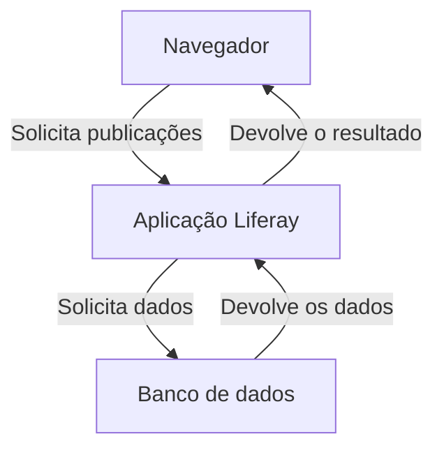

# Cliente e servidor

## 1. O que é o modelo cliente-servidor?

**Cliente-servidor** é um modelo de comunicação em que um componente, o **cliente**, solicita um recurso ou uma operação a outro componente, o **servidor**. O servidor recebe a solicitação, realiza o processamento necessário e devolve uma resposta.

Ao abrir uma página de publicações do Liferay, por exemplo, o navegador solicita informações à aplicação. O Liferay atende à solicitação, e o navegador utiliza o resultado para apresentar o conteúdo ao usuário.

Esse modelo permite que um programa utilize funcionalidades de outro sem precisar executar toda a implementação dentro do próprio processo. O cliente precisa saber como se comunicar com o servidor, mas não precisa conhecer todos os detalhes de como a solicitação é atendida.

Na Web, essa comunicação costuma utilizar HTTP. Aqui, o foco está nos **papéis dos participantes e nas consequências dessa divisão**. A estrutura das mensagens é explicada em [HTTP](./http.md), e os contratos de interação são desenvolvidos em [API](./api.md).

## 2. Cliente e servidor são papéis

Os termos não identificam uma linguagem de programação nem exigem dois computadores diferentes. Eles descrevem a função desempenhada por um componente em determinada interação.

| Participante | Papel na interação |
|---|---|
| Navegador que solicita uma página | Cliente do servidor Web |
| Script JavaScript que consulta publicações | Cliente da API consultada |
| Programa Java que utiliza o client JAR do REST Builder | Cliente da API disponibilizada pelo Liferay |
| Aplicação Liferay que atende a essas requisições | Servidor para esses clientes |
| Banco de dados que atende às consultas da aplicação | Servidor de banco de dados |

Um cliente não precisa possuir interface gráfica. Um script de terminal, uma rotina agendada ou outra aplicação de backend também podem consumir um serviço.

Da mesma forma, um servidor não precisa corresponder a um computador físico exclusivo. A palavra pode designar o programa que atende às solicitações; em outros contextos, também é usada para a máquina que o executa. Ao estudar uma arquitetura, vale distinguir **o software servidor** da **infraestrutura onde ele está hospedado**.

### O mesmo componente pode exercer os dois papéis

Quando o Liferay recebe uma requisição do navegador, atua como servidor nessa relação. Se, durante o processamento, sua aplicação consulta um banco de dados, atua como cliente do banco nessa outra relação.

Portanto, dizer apenas que um programa “é cliente” ou “é servidor” pode ser insuficiente. A pergunta mais precisa é: **cliente ou servidor em relação a qual outro componente?**

## 3. Onde cada parte executa?

No desenvolvimento local, o navegador, o Liferay e o banco de dados podem executar no mesmo computador. Ainda assim, continuam sendo programas com responsabilidades e ambientes de execução distintos.

O navegador não passa a executar o código Java do Liferay só porque ambos estão na mesma máquina. Ele se comunica com a aplicação por meio da interface disponibilizada por ela.

Também é importante distinguir **onde um arquivo é entregue** de **onde seu código executa**. Um servidor pode fornecer HTML, CSS e JavaScript ao navegador. Depois de recebido, o JavaScript da página executa no ambiente do navegador e pode realizar novas solicitações ao servidor.

No caso de um widget React instalado no Liferay:

- O Liferay disponibiliza os arquivos necessários para carregar o widget.
- O JavaScript do widget executa no navegador do usuário.
- Quando esse código solicita publicações à Headless Delivery API, atua como cliente do Liferay.

Assim, **estar instalado ou ser servido pelo Liferay não significa que todo o código do widget execute no backend**.

### O significado de localhost

`localhost` se refere ao ambiente de rede do próprio programa que utiliza o endereço. Em uma instalação local simples, acessar `http://localhost:8080` no navegador significa procurar um serviço na porta `8080` da própria máquina.

Se outra pessoa abrir esse mesmo endereço no computador dela, estará procurando um serviço no computador dela, não no seu. Em ambientes com containers, o contexto também importa: o `localhost` dentro de um container normalmente se refere ao próprio container, e não ao host ou a outro container.

A porta ajuda a distinguir serviços acessíveis no mesmo endereço. Por isso, vários programas podem funcionar na mesma máquina sem representar um único servidor ou uma única aplicação.

## 4. Relação com frontend e backend

Em uma aplicação Web com interface gráfica, é comum que o **frontend** atue como cliente e o **backend** como servidor. Porém, os termos destacam aspectos diferentes.

| Termos | O que descrevem |
|---|---|
| Cliente e servidor | Os papéis dos participantes em uma interação |
| Frontend e backend | A divisão da aplicação entre apresentação e processamento de backend |

Um programa Java de terminal que consome uma API é cliente, mesmo sem ser o frontend de uma aplicação Web. Um backend que consulta outro serviço também atua como cliente nessa comunicação.

Essa distinção ajuda a compreender os exercícios: tanto um widget React quanto um programa Java podem consumir a mesma API do Liferay, embora tenham formas de execução e apresentação diferentes.

## 5. Por que separar cliente e servidor?

### Compartilhamento de funcionalidades e dados

Um servidor pode atender a vários clientes. A mesma aplicação pode disponibilizar dados para um navegador, um aplicativo móvel e uma integração Java.

Isso permite concentrar operações compartilhadas em um serviço, em vez de implementar e manter uma versão independente de todo o processamento em cada consumidor.

### Independência de implementação

Cliente e servidor não precisam utilizar a mesma linguagem. Um cliente JavaScript pode se comunicar com um servidor Java porque ambos seguem regras comuns de comunicação e representação dos dados.

Também não precisam ser atualizados sempre ao mesmo tempo. Essa independência depende de preservar a compatibilidade da interface utilizada: uma alteração no comportamento esperado pode exigir mudanças nos consumidores.

### Distribuição do trabalho

O cliente pode executar tarefas de apresentação e interação, enquanto o servidor realiza operações compartilhadas e acessa recursos controlados pela aplicação.

Essa divisão não elimina o trabalho do cliente nem garante desempenho por si só. Ela distribui responsabilidades e permite decidir onde cada processamento faz mais sentido.

## 6. A comunicação tem custo e pode falhar

Chamar uma função no próprio processo e solicitar uma operação a outro processo não são situações equivalentes. A comunicação com um servidor envolve envio de dados, espera pelo processamento e recebimento do resultado.

Algumas consequências práticas são:

- **Latência:** o resultado não chega imediatamente. Mesmo uma operação simples pode levar tempo por causa da comunicação ou da carga do servidor.
- **Falhas independentes:** o cliente pode continuar aberto enquanto o servidor está indisponível; o servidor também pode continuar funcionando após o cliente se desconectar.
- **Resultados fora de ordem:** se o cliente envia várias solicitações, as respostas podem chegar em uma ordem diferente da de envio.
- **Concorrência:** vários clientes podem consultar ou alterar os mesmos dados, de modo que a informação exibida em uma tela pode ficar desatualizada.

Isso explica por que uma interface precisa considerar situações de carregamento, sucesso e falha. O mecanismo usado para organizar esse estado no React é tratado em [React Hooks e renderização](./react-hooks.md).

Há ainda uma distinção importante: **não receber a resposta não prova que a operação deixou de acontecer**. O servidor pode concluir um cadastro e a conexão falhar antes de o resultado chegar ao cliente. Repetir a solicitação sem considerar essa possibilidade pode gerar um cadastro duplicado, dependendo da operação e das garantias oferecidas pelo serviço.

O modelo cliente-servidor, sozinho, não resolve essas situações. A aplicação precisa definir como lidar com elas conforme suas necessidades.

## 7. A separação estabelece uma fronteira de confiança

O servidor não controla todas as solicitações que um cliente pode enviar. Mesmo que a interface ofereça apenas determinados campos e botões, alguém pode produzir uma requisição por outro programa.

Por isso, esconder um botão ou validar um formulário melhora a experiência de uso, mas não determina o que o servidor deve aceitar. As regras que protegem dados e operações precisam ser aplicadas pelo servidor responsável por eles.

Além disso, o código JavaScript entregue ao navegador pode ser inspecionado pelo usuário. Uma senha de serviço colocada nesse código não se torna secreta por estar dentro de uma função ou de um arquivo compilado.

O ponto arquitetural é que **o cliente solicita; o servidor decide se pode atender e em quais condições**. Os mecanismos de autenticação e autorização são apresentados em [API](./api.md), e a aplicação das regras no Liferay é explicada em [Fluxo de uma requisição no Liferay](./liferay-request-flow.md).

## 8. Relação com as atividades deste repositório

Nos exercícios, o cliente muda, mas a ideia de comunicação permanece:

| Situação | Cliente | Servidor solicitado |
|---|---|---|
| Testar uma API pelo Postman | Postman | Aplicação que disponibiliza a API |
| Executar um programa com o client JAR do REST Builder | Programa Java que utiliza o JAR | Liferay com a API implantada |
| Consultar publicações em um widget React | JavaScript em execução no navegador | Liferay com a Headless Delivery API |

O **client JAR** facilita a construção das chamadas no programa Java. Ele não substitui o servidor nem executa localmente a implementação remota da API. Para uma chamada remota funcionar, a aplicação que disponibiliza a operação precisa estar acessível e preparada para atendê-la.

Também é útil separar o objetivo de cada material teórico:

- [HTTP](./http.md) explica como as mensagens Web são estruturadas.
- [API](./api.md) explica a interface oferecida ao consumidor.
- [Camada de API e separação de responsabilidades](./api-layer-and-separation-of-concerns.md) explica como organizar o código que realiza as chamadas no cliente.
- [Fluxo de uma requisição no Liferay](./liferay-request-flow.md) acompanha o processamento pelas camadas internas da aplicação.

## 9. O que você deve guardar

- Cliente e servidor são papéis relativos a uma interação; um mesmo programa pode exercer ambos.
- Eles podem executar no mesmo computador e continuam possuindo ambientes de execução distintos.
- Um cliente não precisa ser um navegador nem possuir interface gráfica.
- Receber um arquivo do servidor não significa executar seu conteúdo no servidor.
- Comunicar-se com outro processo envolve espera, possibilidade de falha e acesso concorrente aos dados.
- O servidor precisa aplicar as regras das operações, independentemente do comportamento da interface cliente.
